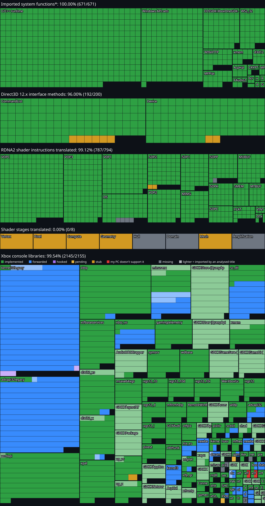

# fucking-frankenstein

**Xbox Series X|S and Xbox One (GDK) games on PC, stitched together from every open project that got part of the way there.**

The body is [TomBox](https://github.com/drycheetah84/TomBox): a runtime that reimplements the console platform layer (Xbox-flavoured Direct3D 12, precompiled RDNA2 shaders, unified-memory textures, the console system libraries) so dumped, already-decrypted builds run as ordinary Windows processes. The other organs are grafted from projects that solved one piece better:

| Part | Donor | What it brings |
|---|---|---|
| Runtime, D3D12.x, console libraries, RDNA2 → HLSL/DXIL translator | [TomBox](https://github.com/drycheetah84/TomBox) (base `7e8064f`), [omonkeyz/xbox-emulator](https://github.com/omonkeyz/xbox-emulator) | Everything that already boots real titles |
| Shaders without a root signature, bindless T# / S#, memory at the console GPU address | [Leonida](https://github.com/ItsNotRexed/Leonida) (GTA VI recompilation, GPL-3.0-or-later) | The resource model GTA VI's 26,503 shaders need (ported as *memory-descriptor mode*, see below) |
| Ideas only (core is GPL-2.0-only, so no code) | [americas-recomp](https://github.com/realdody/americas-recomp) | Static-recompilation layout; MIT-licensed files only, per its REUSE.toml |

Uses legally obtained, already-decrypted dumps of games you own. The project does no key extraction or package decryption and ships no game files.

**Source:** the Rust workspace is in [`crates/`](crates/), [`tools/`](tools/) and `Cargo.toml`. Licensed GPL-3.0-or-later ([LICENSE](LICENSE)); releases before the relicense remain available under MIT OR Apache-2.0. Contributions welcome, see [CONTRIBUTING.md](CONTRIBUTING.md).

## Where it stands (2026-11-22)

| Area | State |
|---|---|
| Imported system functions (Fortnite EXE) | 671 / 671 covered |
| Direct3D 12.x interface methods | 200 / 200 |
| RDNA2 instructions verified | 813 / 820 |
| Xbox console library exports | 2,147 / 2,155 |
| Full shader sweep of the tested titles | 105,506 / 105,506 translate |
| Shaders without a root signature (GTA VI mesh programs) | **New:** buffers *and* images / samplers translate in memory-descriptor mode; runtime side not wired yet |
| Translator checked on real GPUs | **New:** GitHub Actions (Windows, WARP + DXC) and a Steam Deck (RDNA2, Proton / vkd3d-proton / RADV) |
| Mesh / amplification stages | Translate; wave size now taken from the FSSM header |
| Audio | Not working in titles |
| Input | Not working in titles |

Squares and badges are generated by <code>tools/progress/gen.py</code> (green done, amber partial, grey missing); per-function tables in <a href="docs/LIBRARY_MAP.md">docs/LIBRARY_MAP.md</a>, numbers in <a href="tools/progress/summary.json">tools/progress/summary.json</a>.

## Titles

| Title | Build | Result |
|---|---|---|
| Fortnite (Chapter 2 Season 4) | 2.0.1461.7919 | Boots, logs in to a local backend, reaches the Battle Royale lobby. 2D interface correct; 3D scene lit but materials wrong, bloom artifacts. No audio, no input. Not playable. |
| Trackmania | 1.6.2.0 | **Boots and plays on the upstream developers' PC:** menus, login against the in-process backend, the Training - 01 race at about 60 fps, keyboard and controller. Video screens, billboards and streamed textures are black; stencil-tested lighting is dark. **Steam Deck (Proton, through `tombox-launch`):** the runtime, D3D12 device, shader translation and PSOs come up, then a null sub-object crashes it before the first frame (see docs/HANDOFF.md). |
| Terraria | 4.4.14.1081 | **Reaches its world** at 60 fps; keyboard and controller work when played by hand. Automated runs still crash some seconds after the world appears. |
| XDefiant | 1.0.0.186 | Boots to first frames (~26 s) at under 1 fps while shader and pipeline compiles block, then crashes. |
| Minecraft (Beta) | 1.18.3064.0 | Boots past the welcome screen to the menu (~44 s), then crashes in automated runs. |
| Grand Theft Auto VI | 1.0.2.1 | **Not run: no executable exists in any dump.** Shader package examined (26,503 shaders). The blocker that stopped two thirds of them, resources bound without a root signature, now has a translator answer (memory-descriptor mode); the rest of the road is in the [roadmap](docs/ROADMAP.md). |

## What changed in the last round

Each item is its own branch and pull request in this repo, with an issue describing the problem first.

**Translator (tombox-xshader)**
- Memory-descriptor mode for shaders with no root signature ([#24](https://github.com/fffluffy-dev/xbox-emulator/issues/24), [#25](https://github.com/fffluffy-dev/xbox-emulator/pull/25)). Ported from Leonida's runtime contract: s0–s31 come from a runtime constant buffer, memory is read at the console GPU address through windows, V# buffers are bounds-checked from the descriptor the shader loaded, and T# / S# are looked up by an FNV-1a key in a table the runtime keeps, then taken from `ResourceDescriptorHeap` / `SamplerDescriptorHeap` (SM 6.6). Unknown descriptors read a null view and are counted.
- Round-mode emulation fixed for drivers that fold `(double)(float)x` to `x` (vkd3d-proton / RADV) ([#20](https://github.com/fffluffy-dev/xbox-emulator/issues/20), [#21](https://github.com/fffluffy-dev/xbox-emulator/pull/21)). Verified on the Steam Deck: 0 failures.
- Mesh-shader wave size from the FSSM header: 616 wave64 programs were treated as wave32 ([#22](https://github.com/fffluffy-dev/xbox-emulator/issues/22), [#23](https://github.com/fffluffy-dev/xbox-emulator/pull/23)).
- Vertex inputs placed from the FSSM input table, including merged VS (`MainForGS`) ([#15](https://github.com/fffluffy-dev/xbox-emulator/issues/15), [#16](https://github.com/fffluffy-dev/xbox-emulator/pull/16)).
- GFX10 image atomics decode and honour GLC ([#5](https://github.com/fffluffy-dev/xbox-emulator/issues/5), [#6](https://github.com/fffluffy-dev/xbox-emulator/pull/6)); MIMG TFE status VGPR written ([#4](https://github.com/fffluffy-dev/xbox-emulator/issues/4), [#2](https://github.com/fffluffy-dev/xbox-emulator/pull/2)); store/atomic data registers count as entry inputs ([#11](https://github.com/fffluffy-dev/xbox-emulator/issues/11), [#12](https://github.com/fffluffy-dev/xbox-emulator/pull/12)).
- Fuzzing: 300,000 random programs, 0 panics after two fixes ([#9](https://github.com/fffluffy-dev/xbox-emulator/issues/9), [#10](https://github.com/fffluffy-dev/xbox-emulator/pull/10)).
- GCN lowering: SMRD `s_memtime` / `s_dcache_inv` mapping and CI `buffer_wbinvl1_vol` ([#7](https://github.com/fffluffy-dev/xbox-emulator/issues/7), [#8](https://github.com/fffluffy-dev/xbox-emulator/pull/8)).

**Testing without the developer's PC**
- CI on GitHub Actions: Linux portable tests, Windows translator tests with DXC and D3D12 (WARP), the workspace, d3d12_xs hardware tests and a runtime bundle ([#13](https://github.com/fffluffy-dev/xbox-emulator/issues/13)).
- The portable tests build on Linux ([#3](https://github.com/fffluffy-dev/xbox-emulator/issues/3), [#1](https://github.com/fffluffy-dev/xbox-emulator/pull/1)).
- Steam Deck as a real RDNA2 test machine: 81 / 89 GPU tests passed on the first run; the rest were test assumptions or driver folds, fixed in [#19](https://github.com/fffluffy-dev/xbox-emulator/pull/19) and [#21](https://github.com/fffluffy-dev/xbox-emulator/pull/21) ([#18](https://github.com/fffluffy-dev/xbox-emulator/issues/18)).

## Roadmap

The full plan, with what blocks each step, is in **[docs/ROADMAP.md](docs/ROADMAP.md)**. In short:

1. **Land the open pull requests** and keep CI green.
2. **Finish the GTA VI resource model:** the d3d12_xs runtime fills the user data, maps memory windows and keeps the T# / S# table (memory-descriptor step 3).
3. **More titles playable:** Trackmania already plays on the upstream PC; next are its black video and stencil passes, Terraria past its automated-run crash, XDefiant past its first frames, and Trackmania on the Steam Deck.
4. **Fortnite in game:** correct 3D materials, audio, controller and keyboard.
5. **GTA VI:** everything that can be done without an executable now; boot when one exists.

## Documents

- [docs/ROADMAP.md](docs/ROADMAP.md) — the plan
- [docs/MILESTONES.md](docs/MILESTONES.md) — milestones with evidence (generated)
- [docs/DEVELOPMENT_LOG.md](docs/DEVELOPMENT_LOG.md) — chronological log
- [docs/BLOCKERS.md](docs/BLOCKERS.md) — standing walls
- [docs/LIBRARY_MAP.md](docs/LIBRARY_MAP.md) — per-library, per-function status (generated)
- [docs/LIBRARY_DISCOVERY.md](docs/LIBRARY_DISCOVERY.md) — what the dumps contain

## Credit

[drycheetah84/TomBox](https://github.com/drycheetah84/TomBox) (base commit `7e8064f`) and [omonkeyz/xbox-emulator](https://github.com/omonkeyz/xbox-emulator) for the runtime (synced with its `main` at `1e77fcc`, 2026-11-22, including its contributors' work up to PR #169); [ItsNotRexed/Leonida](https://github.com/ItsNotRexed/Leonida) for the GTA VI resource model ported into the translator. The progress map keeps TomBox's metric definitions so its numbers stay comparable.
